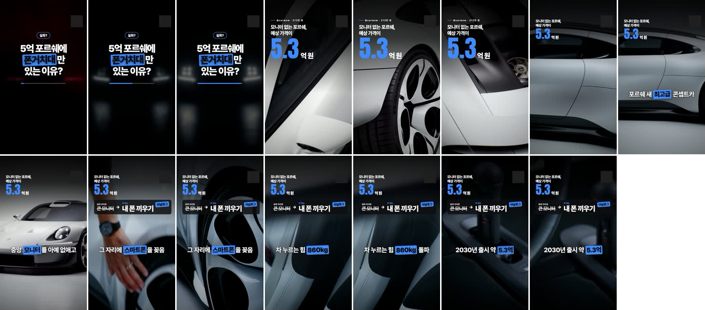
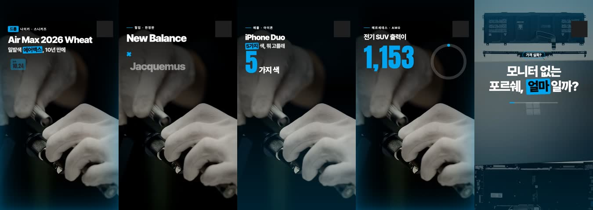
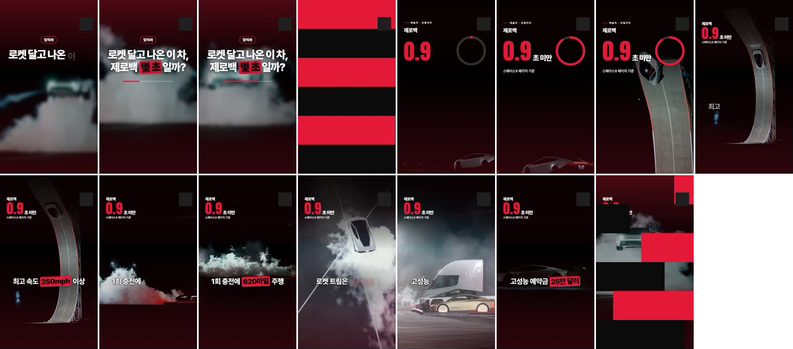
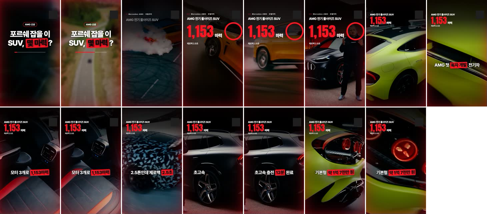

# shortform-autogen — an unattended short-form video factory

An end-to-end pipeline that turns "just-launched product" news into Korean vertical short-form videos (Reels / Shorts) every morning with no human in the loop: it discovers what is hot (RSS feeds + YouTube charts), scores candidates for *wow*, writes a plain-language script with Gemini (search-grounded), pulls clean cuts from the maker's official footage with vision checks, renders a React motion-graphics template frame by frame in headless Chromium, mixes Google TTS, Lyria background music and synthesized SFX, runs QA, and emails the finished reels with ready-to-paste captions.

Built in six days (2026-10-17 → 10-22). Ran first under macOS `launchd`, then on a self-starting GCE VM. Paused when YouTube began blocking video downloads from cloud IPs. The code, the rules, and the 60+ recorded lessons are the portfolio. Cost per finished reel: roughly $0.25 in API calls.

Channel name, handle and logo are operator settings (`.env`, `props.logoText`) and are not part of this repository. Inline code comments are in Korean; all documents have English versions, with the Korean originals under [`docs/ko/`](docs/ko/).

<p align="center">
  
  <br><sub>Porsche Mission S concept reel (33 s): layout intro → subtitle-synced body → outro. Cuts come from two official Porsche videos. The top-right badge is masked.</sub>
</p>

---

## 1. What it does

| Stage | Work | Where |
|---|---|---|
| **D1 Discover** | 36 media RSS feeds (tech, fashion, cars, inventions) + official YouTube RSS of 55 brands + **YouTube's official most-popular charts** (4 regions × 5 categories, Data API) + 48-hour view-sorted API search | `discover/news.py` `collect.py` `hot.py` |
| **D2 Select** | Gemini 3.1 Pro with Google Search grounding picks 8 "things" announced in the last 48 h; an **independent Flash judge re-scores wow (1–10)** and anything below 7 is dropped; candidates are re-ranked by today's YouTube views; a 14-day second pass runs if the pool is thin | `auto/plan.py: pick / judge_wow / heat_rank` |
| **P2 Source** | Only footage from the maker, brand or research institution's **official channel** (one main video + up to two context videos: predecessor, launch event). Channel matching uses brand and product-name tokens | `official_videos / viral_videos` |
| **P2 Cuts** | 9:16 tile sheets go to Gemini vision for cut selection, then every cut is re-checked for **dark frames (ffmpeg luma), person-dominant frames, and burned-in text**; cuts are shifted within ±40 s, and the topic is discarded if more than half cannot be fixed | `choose_cuts / verify_cuts / burned_subtitles` |
| **P1 Script** | One of 14 layouts chosen by the shape of the information; "a middle-schooler understands it on first listen" rule; foreign prices converted to KRW with a daily rate; **every number in the script must exist in the sourced facts** (one rewrite if not) | `write_spec / unsourced_numbers` |
| **P3 Render** | A React template (built with claude.ai/design) is **captured frame by frame in headless Chromium** at 1080×1920 30 fps. TTS → read back with STT for validation → word offsets align subtitles and cut boundaries. Lyria BGM with sidechain ducking, six synthesized SFX, colour grade, optional end card | `produce/render/design_reel.py` `reel-template.jsx` |
| **P4 QA** | Resolution, fps, length (20–40 s), loudness (−14 to −11 LUFS), handle, and **every 3+ digit number cross-checked against sources** | `produce/qa.py` |
| **Deliver** | One email per reel (title, paste-ready caption, sources, wow score, QA warnings). Files over 18 MB are re-encoded. Already-sent files are never resent | `auto/send.py` |

<p align="center">
  
  <br><sub>Five of the 14 layouts: drop · collab · colorway · stat · question. Three themes (dark/tint/neon) × 8 accent colours × 3 transitions × 5 voices multiply the variety.</sub>
</p>

<p align="center">
   
  <br><sub>Left: Tesla Roadster (49.8 M YouTube views in 7 days; auto-selected as the hottest topic). Right: AMG electric SUV, alternating between two official videos.</sub>
</p>

## 2. Architecture

```
          36 RSS feeds · 55 brand channel RSS · YouTube charts/search (API) · FX rate API
                                   │
                        discover/  news.py · collect.py · hot.py
                                   ▼
   ┌──────────── auto/plan.py (daily runner, 110-minute budget) ───────────────┐
   │ pick(Gemini 3.1 Pro + Google Search) ─▶ judge_wow(Flash) ─▶ heat_rank       │
   │ official_videos(yt-dlp, main + context) ─▶ choose_cuts(vision) ─▶ verify_cuts│
   │ write_spec(script · caption · title, number pre-check) ─▶ make_spec(theme)   │
   │ render ─▶ qa ─▶ outbox/  (retries: spell numbers, shift cuts, adjust speed)  │
   └──────────────────────────────┬────────────────────────────────────────────┘
                                  ▼
    produce/render/design_reel.py   TTS (gemini-3.1-flash-tts) → STT read-back check → alignment
                                    base.mp4 (ffmpeg 9:16 crop, grade) → Chromium frame capture
                                    Lyria BGM + SFX + ducking mix → x264 CRF 14 → end card (optional)
                                  ▼
    auto/send.py  (Gmail SMTP)  ←  runs/<date>/outbox/*.mp4 + *.txt
```

Two runtimes were used.
- **macOS launchd** (10/17–10/19): produce at 06:00, send at 08:00. Lessons: a project under `~/Desktop` is silently blocked by TCC for launchd agents; a sleeping laptop only progresses in 45-second DarkWake windows.
- **Self-starting GCE VM** (10/20–): an instance schedule powers it on at 05:55 KST, systemd runs `deploy/run_daily.sh` (produce → send → poweroff), and a 150-minute watchdog timer prevents idle burn. See [`deploy/README.md`](deploy/README.md).

## 3. Running it

```bash
cp .env.example .env            # GCP_PROJECT, MAIL_TO, GMAIL_APP_PASSWORD, CHANNEL_NAME, HANDLE, optional YOUTUBE_API_KEY
python3 -m venv .venv && .venv/bin/pip install playwright pillow yt-dlp
.venv/bin/python -m playwright install --with-deps chromium   # macOS uses the installed Chrome
gcloud auth login                # a project with Vertex AI (Gemini, Lyria), Cloud TTS and STT enabled

python3 -I auto/plan.py --want 3 --viral 1 --dry-pick   # collect + select only (inspect candidates and wow scores)
python3 -I auto/plan.py --want 3 --viral 1              # full production → runs/<date>/outbox/
python3 -I auto/send.py --date 2026-10-20 --wait 0      # email the reels
python3 -I auto/rewrite.py runs/2026-10-20 auto1        # keep the cuts, rewrite the script under current rules, re-render
```

- Cost per reel (estimate): TTS + STT ≈ $0.03, Lyria $0.04, Gemini Pro selection / script / cut picking ≈ $0.10–0.20, simple vision checks on Flash. Total ≈ $0.25. Rendering is local CPU (about 5 minutes per reel on e2-standard-8).
- Secrets live only in `.env`. Never in code, logs or chat.

## 4. The rules are the product

- [`LESSONS.md`](LESSONS.md) — 60+ dated lessons. The rule: one anomaly = one lesson entry + a code or rule change the same day.
- [`RESEARCH.md`](RESEARCH.md) — what pays (affiliate commission by category, brand programs), a breakdown of 8 top-performing shorts (filmstrips, cut-rate detection), and the visual upgrade plan.
- [`produce/SPEC_RULES.md`](produce/SPEC_RULES.md) — how to choose among the 14 layouts, script length, plain-language and sourced-number rules.
- [`docs/OPERATIONS.md`](docs/OPERATIONS.md) — the stage gates, commands and automation backlog from the operating period (partly from the earlier dashboard era).

## 5. Lessons in one screen

1. **Validate under conditions the machine hears well.** Reading 1.5× TTS back through STT discarded perfectly good audio → validate and align at 1.0×, speed up only for playback.
2. **If you shift a timeline, shift everything that reads it.** Prepending a hook scene broke the progress bars because `bodyTimes` and `cardAt` were not offset.
3. **Whatever the model chooses, the code verifies.** Given an empty list it invents video ids; it scores its own picks generously (a wristwatch: 7/10); it dates products from memory (a year-old camera as "announced yesterday") → list cross-checks, an independent judge, and a 45-day official-video rule.
4. **Cut checks must ask "is the product large and bright", not "is there text".** A six-second black intro and a robot reel showing mostly a presenter's torso led to a triple check: luminance, person-dominance, text.
5. **Views and re-editability are different things.** A 7.4 M-view short with captions burned across the centre cannot be reused → viral videos are a *signal* of what is hot; footage comes from the maker's channel.
6. **Unattended automation needs a runtime that never sleeps.** Laptop DarkWake, 1-hour token expiry, and a `grep -q 1` that matched "v1" in a 404 body (skipping the daily job and idling a VM for 31 hours) are all in the lessons.
7. **"Short and fast" was my assumption.** The viewer's bar is "readable and understood" → 1.1× narration, minimum scene lengths, no mid-word line breaks (`keep-all`), always convert foreign prices.

## 6. Status and next steps

- **Paused on 2026-10-22.** YouTube started answering per-video metadata and download requests from cloud IPs with "Sign in to confirm you're not a bot". Selection still worked (it picked a kung-fu humanoid, Tesla Optimus, a flying car), but every candidate failed at the sourcing step. All cloud resources were deleted.
- To resume: place a `cookies.txt` (YouTube login cookies, ideally from a throwaway account) in the repository root and every yt-dlp call picks it up automatically. A residential proxy is the alternative.
- Open work: sourcing for categories with little official footage (fashion, sneakers), the trade-off between daily volume and the wow threshold, upload APIs (YouTube, Instagram), and performance tracking.

## 7. Layout

```
auto/        plan.py (daily runner) · send.py (email) · rewrite.py (script rewrite) · vx.py (Vertex calls, token refresh, retries)
discover/    news.py (RSS) · collect.py (brand YouTube RSS) · hot.py (charts, search, metadata)
produce/     render/ (design_reel.py · reel-template.jsx · animations-v3.jsx · fonts · sfx) · qa.py · sources.py · SPEC_RULES.md
config/      brands.json · channels.json
deploy/      GCE setup, sync, boot job and watchdog scripts
docs/        OPERATIONS.md · images/ · ko/ (Korean originals)
```

Fonts (Pretendard, Anton, Unbounded) are under the SIL Open Font License 1.1. Code is MIT.
